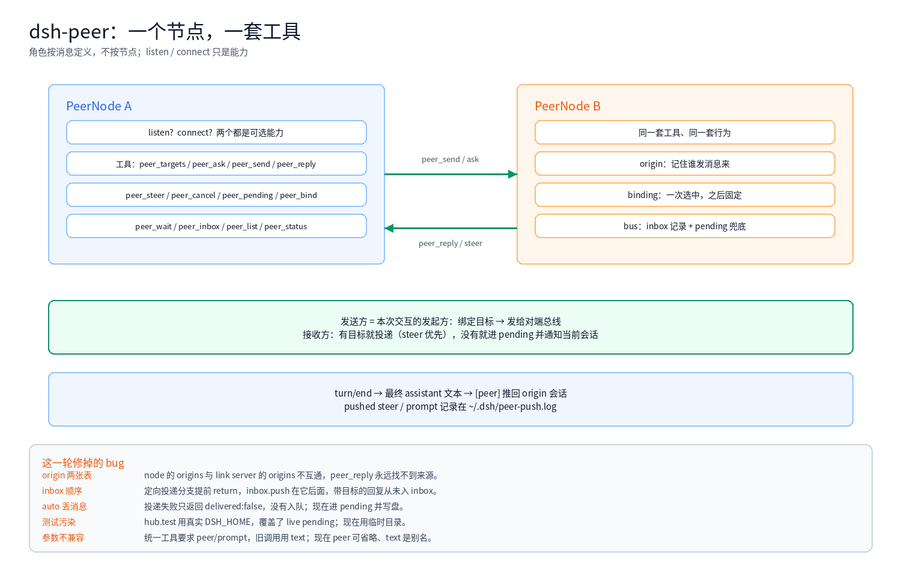

前面两篇做了[会话选择](/architecture/dsh-peer-selection.html)和[异步回传](/architecture/dsh-peer-result-push.html)。这一篇是收尾：**把 hub / link 两个角色拆掉**。

只要节点分两种，工具就会有两套，行为就会有一半是坏的；每修一次都在制造新的不对称。

<!-- more -->

## 1. 错误的起点

最初的模型：

```text
hub  = 监听、路由、管理 pending
link = 连接、回复
```

于是工具也分了两套：

- hub：`peer_ask` / `peer_send` / `peer_steer` / `peer_cancel` / `peer_pending` / `peer_bind` ...
- link：`peer_reply` / `peer_send` / `peer_status`

结果：

- link 不能 `peer_ask`，只能发完等推送
- link 没有 `peer_pending` / `peer_inbox`，看不到入站记录
- origin 只在 hub 侧记，link 回复时找不到来源

**角色不是节点属性，是一次交互的属性**：谁发消息，谁就是这次的发起方；谁收到，谁就是目标。同一对节点下一轮可以反过来。

## 2. 一个节点



```text
PeerNode
├─ listen?    可选能力
├─ connect?   可选能力
├─ 同一套工具（12 个）
├─ origin     本地会话 ↔ 对端会话
├─ binding    一次选中，之后固定
└─ bus        inbox 记录 + pending 兜底
```

`index.js` 两边都构造 `PeerNode`，把现有传输包成 capability，然后调用**同一个** `registerPeerTools`。

## 3. 一套工具

```text
peer_targets  列对端工作区和会话
peer_ask      发问并等待
peer_send     发送，不等待
peer_reply    回复来源会话
peer_steer    插进对端当前轮
peer_cancel   中断对端回合
peer_pending  未投递的消息
peer_bind     把 pending 投进某个会话
peer_wait     等下一帧入站消息
peer_inbox    已记录的入站消息
peer_list     连接情况
peer_status   自身状态
```

两端工具名、参数、行为一致。`peer` 在只有一个对端时可以省略，`text` 是 `prompt` 的别名。

## 4. 一次绑定，之后固定

```text
某会话第一次给 peer 发消息
  → userQuestions.ask：远端工作区 + 远端会话
  → 记住 binding（本地会话 + peer → 远端会话）
  → 之后不再问
```

如果当前会话已经有 **origin**（对端发过消息来），直接用它，不弹卡片——无人值守的节点不会卡在选择上。

## 5. 反向能力

hub 新增：

```text
peer/steer   通过 sessionController 或 agent 插进本地会话
peer/cancel  中断本地会话
```

link 的 `peer_steer` / `peer_cancel` 调这两个方法，默认目标是 origin。

## 6. 轻量总线

没有引入完整的消息协议，只做“记录 + 兜底”：

```text
入站消息
  → 记 inbox（peer_wait / peer_inbox 读这里）
  → 有目标且可写 → 投递
  → 失败 → 进 pending（peer_pending / peer_bind）
```

每条入站都记录，但只有投递失败才排队。这样既不会“推了但看不到”，也不会把正常消息堆在队列里。

## 7. 感知问题：queue 还是 steer

这是最隐蔽的一个。

消息投递用了 `sessionController.prompt(mode: 'queue')`，于是：

- 投递返回成功
- 但消息排在**下一轮**
- 当前回合还在跑，agent 看不到
- 用户却在 GUI 里看到“排队消息”，问：你为什么感知不到？

改成 `mode: 'steer'`：插进当前轮的下一个 step，agent 当场看到。若会话空闲，steer 也会起一轮。

另外，消息进 pending 时，hub 会给最近活跃的会话发一条提示：

```text
[peer] macmini 的这条消息进入了 pending（id）：
...
请用 peer_pending 查看，再用 peer_bind 选择会话。
```

## 8. 这一轮修的 bug

| 现象 | 根因 | 修复 |
|---|---|---|
| `peer_reply` 永远报 no origin | `PeerNode` 的 origins 与 link server 的 origins 是两张表 | `originFor` 回退到 capability |
| 定向回复不进 inbox | 定向投递分支提前 `return`，`inbox.push` 在它后面 | 入站记录移到分支之前 |
| 队列里的消息消失 | auto 模式投递失败只返回 `delivered:false`，没有入队 | 失败进 pending 并写盘 |
| live pending 被测试覆盖 | `hub.test` 用真实 `DSH_HOME` | 测试用临时目录 |
| `peer_send` 参数校验失败 | 统一工具要求 `peer` + `prompt`，旧调用传 `text` | `peer` 可省、`text` 别名 |
| 无人值守节点卡住 | 每次发送都弹选择卡片 | 有 origin 时跳过卡片 |
| 我感知不到排队 | 入站用 queue，当前轮看不到 | 入站改 steer |

## 9. 测试方式也要改

- 单元测试用临时 `DSH_HOME`，不碰 live 队列
- 集成测试用内存传输，不连真实对端
- 真实环境只跑一次收敛验证：步骤 → 预期 → 实际
- 不在生产会话里反复发测试消息

## 10. 教训

- **先对齐模型，再写代码**：节点类型错了，后面全是补丁
- **对称不是口号**：工具、origin、回传、错误处理都要同一份
- **消息和投递分开**：收到 ≠ 投递成功 ≠ 用户看到
- **失败要留痕**：`peer-push.log`、pending 文件、inbox
- **测试要隔离**：测试写真实队列，会把真实数据冲掉
