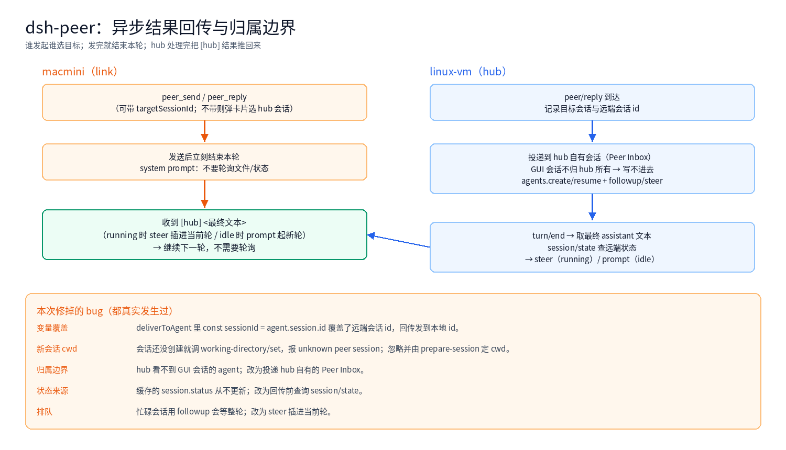

上一篇做了[会话选择](/architecture/dsh-peer-selection.html)。选完之后真正的问题才浮出来：**发出去的消息，结果怎么回到发起方？**

这一篇记录最后的方案——异步回传——以及一路上修掉的几个真 bug。它们不“高级”，但每一个都能让整条链路看起来“完全没通”。

<!-- more -->

## 1. 最终形态



```text
macmini: peer_send / peer_reply（可带 targetSessionId）
  → 立刻结束本轮（system prompt 规定，不要轮询）
hub: 投递到 hub 自有会话（Peer Inbox）
  → 跑一轮
  → turn/end 取最终 assistant 文本
  → session/state 查远端状态
  → running 用 steer / idle 用 prompt
  → [hub] <文本> 推回 macmini 的发起会话
macmini: 收到 [hub] ... → 继续下一轮
```

没有同步阻塞，没有轮询，也没有“hub 的 agent 记得回复”这种人为依赖。

## 2. 归属边界：hub 写不进 GUI 会话

这是最反直觉的一条。DSH 里 agent 有归属：

- GUI 会话的 agent 由 GUI 的会话控制器创建和持有
- peer 插件 `agents.get(那个 id)` 返回空，`resume` 也会失败

所以“把消息投到用户正在看的会话”在插件层面做不到。最终方案是 hub **自己建一个会话**：

```text
会话 id: peer-inbox（或 peer-inbox-xxxx）
归属:    hub 插件
可见:    挂到 workspace，GUI 里能看到
```

peer 消息默认投到这里，它的 agent 起一轮处理，结果再推回 macmini。等于给 peer 通信开了一个“收发室”。

## 3. steer 还是 prompt

回传时 macmini 可能在跑，也可能空闲：

| 远端状态 | 方式 | 效果 |
|---|---|---|
| running | `session/steer` | 插进当前轮的下一个 step，轮询立刻停 |
| idle | `session/prompt` | 起一轮，`[hub]` 作为新一轮输入 |

状态不能信缓存（`session.status` 通知我们从来没收到过），所以回传前直接查：

```js
const state = await link.conn.request('session/state', { sessionId })
const running = state?.status !== 'idle'
```

## 4. 本次修掉的真 bug

| 现象 | 根因 | 修复 |
|---|---|---|
| macmini 永远收不到结果 | `#deliverToAgent` 里 `const sessionId = agent.session.id` **覆盖了参数**，`remoteSessionId` 记成本地 id | 本地 id 只作 map key，`remoteSessionId` 保留远端 id |
| 新建会话报 `unknown peer session` | 会话还没创建就调 `working-directory/set` | 忽略该错误；新会话 cwd 由 `peer/prepare-session` 在创建时带上 |
| hub 找不到 agent，消息落 pending | 归属隔离，GUI 会话不可写 | 投递到 hub 自有的 Peer Inbox |
| 回传总走 prompt、排队 | 缓存的 `session.status` 永远是 idle | 回传前查 `session/state` |
| 忙碌会话等到整轮结束 | `followup` 只能等 | running 时改 `steer` |

第一个 bug 最典型：它不报错、不影响投递，只是**回传发到了不存在的会话**。表现就是“消息明明进了会话，对面就是收不到”。

## 5. 怎么验证

不要靠“看起来应该通了”，要留下证据：

```text
~/.dsh/peer-push.log
2026-11-07T16:16:42.002Z pushed prompt peer-macmini-fix1 bytes=46
```

macmini 端实际收到的内容：

```text
[hub] 收到，已忽略。

（hub 已完成这一轮，直接继续即可，不需要轮询。）
```

一边是推送日志，一边是接收原文，才算闭环。

## 6. 发起方选择的代价

“谁发起谁选目标”是上一轮定下的方向：

- link 发送前用 `userQuestions.ask` 问用户选 hub 会话
- 不带 `targetSessionId` 就会弹卡片；没人点，发送会被取消

这很符合“谁发起谁确认”，但在无人值守时就是阻塞。折中：

- 常用目标（如 `peer-inbox`）设默认，减少弹卡
- 或者把选择结果记住，下一次复用

## 7. 被删掉的东西

中途实现过 `peer_ask_hub`：发送并同步等待 hub 这一轮的文本。它和异步回传重复，而且：

- 阻塞调用方
- hub 会话忙时会一直等
- 存在互等（hub 反过来同步调 link）

最后删掉，只保留异步。**能异步就不要同步**——这是这次最实用的一条。

## 8. 教训

- **归属边界先搞清楚**：不是所有会话都能写，插件只能写自己拥有的
- **回传的 id 必须是远端的**：本地 id 和远端 id 同名变量是灾难
- **状态不要信缓存**：查一次 `session/state` 比维护通知可靠
- **部署后确认进程真的重启了**：我遇到过定时重启没生效、在旧进程上测了半天
- **日志先行**：`peer-push.log` 一加，问题立刻从“玄学”变成“一行失败信息”
