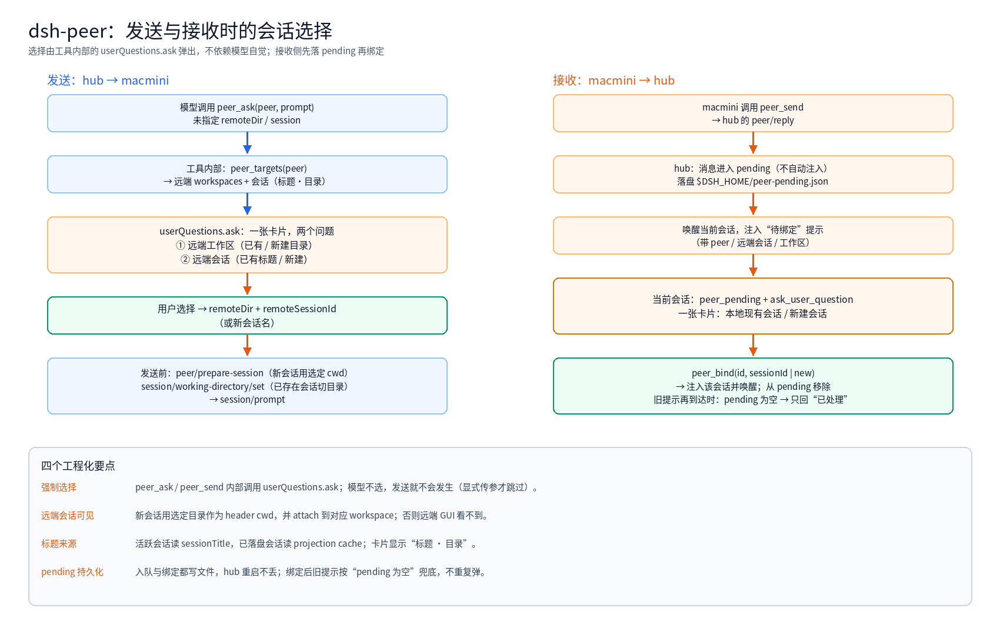

上一篇写了 [steer 与 cancel](/architecture/dsh-peer-steer.html)。这一篇解决另一个问题：**对方发来的消息，应该进哪个会话？我发出去的消息，又该落到对方的哪个工作区、哪个会话？**

最初的做法是"自动注入到最近一次调用的会话"——不可控，也解释不清。现在改成了**用户选择**，而且选择由工具内部强制，不靠模型自觉。

> English version: [Putting the choice on a session](/en/architecture/dsh-peer-selection.html)

<!-- more -->

## 1. 为什么要"选会话"

早期的链路是这样的：

```text
link 发消息 → hub 找"最近向这个 link 发过 peer_ask 的本地会话" → 注入
```

这有三个问题：

- 多个本地会话都问过同一个 peer 时，**最后调用的赢**，回复可能进错会话
- peer 从没被问过的会话发消息时，没有"发起者"，只能进全局兜底
- 对端有几十个会话，用户根本不知道消息会落到哪个

所以把"目标"变成显式选择：**工作区 + 会话**。

## 2. 发送侧：一张卡片选两件事

发送前的流程：



1. `peer_targets(peer)` 拿到对端信息：
   - `workspaces`：对端 dsh 注册的工作区列表
   - `sessions`：全部会话（活跃 + 已落盘），带**标题**和目录
2. 工具内部调用 `userQuestions.ask`，一次问两个问题：
   - 远端工作区：已有工作区 / 新建目录（输入绝对路径）
   - 远端会话：已有会话（显示 `标题 · 目录`）/ 新建会话（输入名字）
3. 用户点完，工具拿到 `remoteDir` 和 `remoteSessionId`，才继续发送

关键点：**这一步在工具内部执行**。`peer_ask` / `peer_send` 的 `execute` 里先 `await pickRemoteTarget(...)`，答案没回来就不会调用 `hub.ask`。模型没有办法"跳过提问直接发"——除非显式传 `remoteDir` + `session`/`remoteSessionId`（运维指令用）。

## 3. 接收侧：先落 pending，再绑定

```text
macmini peer_send
  → hub: peer/reply
  → pending 入队（同时写 $DSH_HOME/peer-pending.json）
  → 唤醒当前会话，注入"待绑定"提示（带 peer / 远端会话 / 工作区）
  → 当前会话：peer_pending + ask_user_question
       一张卡片：本地现有会话 / 新建会话
  → peer_bind(id, sessionId | new)
  → 注入该会话并唤醒
```

几个细节：

- **不自动注入**：消息先停在 pending，避免"落到不知道哪个会话"
- **落盘**：入队和绑定都写文件，hub 重启后 pending 还在
- **竞态兜底**：绑定成功后，若旧提示延迟到达，处理前先查 `peer_pending`；为空就只回"已处理"，不再弹第二次选择

## 4. 远端会话为什么在 GUI 里看不见

这是踩得最久的一个坑。macmini 的 dsh GUI 按 **workspace** 列会话，并且用 **session header 的 cwd** 过滤。peer 会话最初是 link 用默认目录创建的：

```text
session header cwd = /Users/patrick
workspace 列表里没有 /Users/patrick  → 会话不可见
```

修复分两步：

1. 发送时把用户选的目录通过 `peer/prepare-session` 提前告诉 link，**创建会话时直接用这个 cwd 作为 header cwd**
2. 会话创建后，link 找到 cwd 对应的工作区（没有就创建），`attachSession`

对已存在的旧会话，header cwd 改不了，所以仍可能不可见——新会话才会落到你选的目录。

## 5. 会话标题从哪来

卡片的会话列表要显示"和 GUI 里一样的标题"，来源分两种：

| 会话状态 | 标题来源 |
|---|---|
| 活跃（在 link 进程里） | `sessionTitle.get(session).title` |
| 已落盘但未打开 | `sessionProjectionCache.cachedSnapshot(header)` 的 title 投影 |

合并后按 `createdAt` 倒序，最多 30 个；卡片里取最近 8 个，避免太长。

## 6. 这一路踩的坑

| 现象 | 原因 | 修复 |
|---|---|---|
| 卡片里没有已有会话 | hub 只列自己内存里的 `link.sessions`，重启即空 | 向 link 查 `peer/sessions`，合并持久化会话 |
| 选了目录，远端还是 `/Users/patrick` | `working-directory/set` 改的是 projection，header cwd 没变；且 SDK server 的 `ctx.workingDirectory` 需要 inject | link 自己实现 set（`ctx.get`），并在创建前用 `peer/prepare-session` 定 cwd |
| 发送前弹了卡片，显式传参也弹 | 选择函数无条件调用 | 显式 `remoteDir` + `session`/`remoteSessionId` 时跳过 |
| hub 重启后待绑定消息没了 | pending 只在内存 | 落盘 `peer-pending.json` |
| 绑定后旧提示又弹一次选择 | 提示已入队，绑定无法撤回 | 处理前检查 pending；为空只回"已处理" |

## 7. 还没做的

- **应用内原生卡片**：现在的选择卡片是 DSH 的 `ask_user_question` / `userQuestions.ask` 渲染的，已经比较接近原生；但"选择工作区 + 会话"目前是**两个问题的同一张卡**，不是专门的 picker 组件
- **代码级权限约束**：peer 来源的 turn 仍然用用户会话的权限；应该改成受限 preset，特权操作必须真人批准
- **远端会话的 header 迁移**：旧会话的 cwd 无法改，只能新建

## 8. 小结

- 目标选择要**显式**：工作区、会话都让用户点，不猜"最近一次"
- 强制要落在**工具内部**：`userQuestions.ask` 在 `execute` 里，模型跳不过
- 可见性依赖 **header cwd + workspace attach**，不是"建了会话就自动出现"
- 跨进程的状态（pending）要**持久化**，否则一次重启就丢
