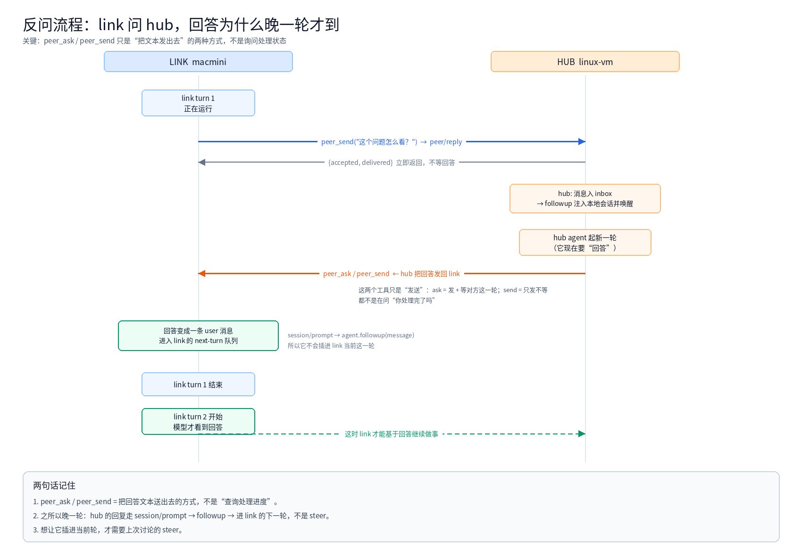
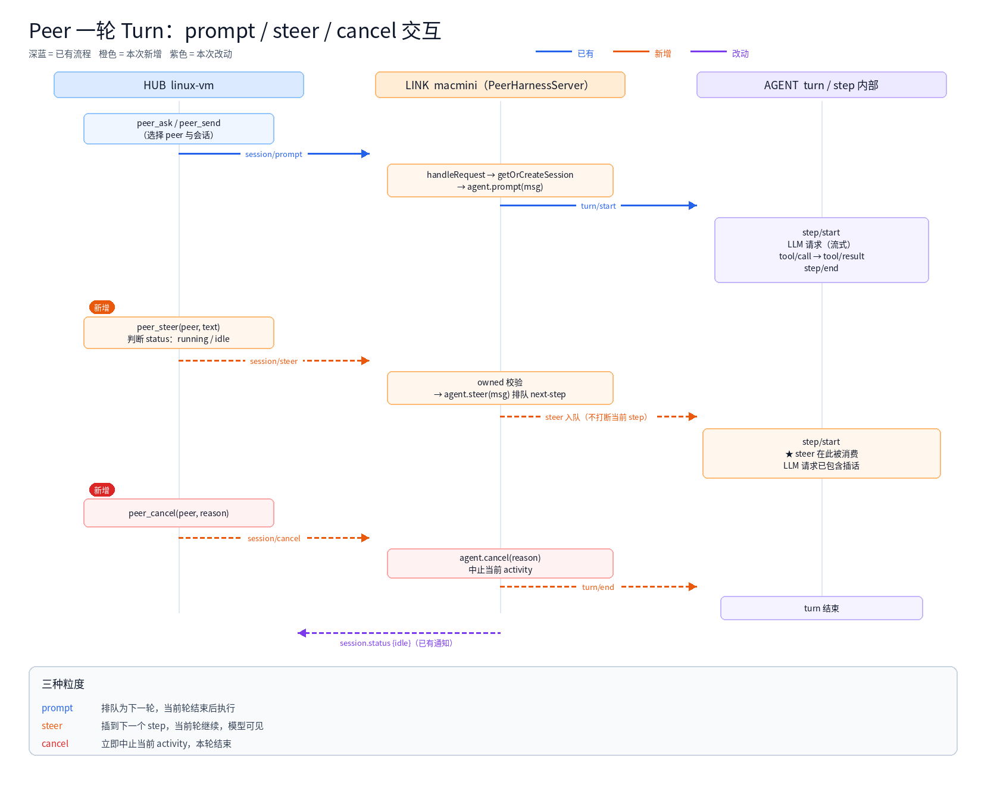

上一篇 [让两个 DeepSeek Harness 跨机器对话](/architecture/dsh-peer.html) 写了 `dsh-peer` 的连接方向和活动看板。这一篇接着写一个更细的问题：**怎么在对方 agent 跑一轮的时候插话，甚至中止它**。

绕了一圈才明白：在 DSH 里，"发消息"其实有三种粒度——`prompt`、`steer`、`cancel`。它们的差别不在网络层，而在 **agent loop 的 turn/step 边界**。这篇把语义、协议和一次真实的联调记录放在一起。

> English version: [Adding steer and cancel to a two-agent channel](/en/architecture/dsh-peer-steer.html)

<!-- more -->

## 1. 起点：peer 调用其实是一个 tool call

对模型来说，`peer_ask` 就是一个普通工具：

```text
assistant: tool/call peer_ask { peer: "macmini", prompt: "帮我跑个长任务" }
tool:      peer_ask 结果 { text: "...", status: "completed", elapsedMs: 42000 }
```

对端是另一台机器上的完整 runtime，有它自己的模型、工具和会话；但在这边，它被包成了"入参是 prompt、出参是最终文本"的函数。

这个抽象有三个天然的短板：

1. **没有流式**：tool 结果一次性返回，看不到对方正在做什么（所以有了镜像会话）
2. **不能反问**：对方不能在同一次调用里问回来
3. **不能抢占**：调用期间无法干预对方

前两个已经用镜像和 inbox 补过；这一次补第三个。

## 2. DSH 里一轮到底是怎么跑的

先把运行时说清楚，否则 `steer` 和 `prompt` 的区别很容易被误解成"发消息的时机不同"。

DSH 的 agent loop 里，**turn 由多个 step 组成**，每个 step 是一次 LLM 请求 + 工具执行：

```text
turn/start
  ├─ step 1: step/start → LLM 请求 → tool/call → tool/result → step/end
  ├─ step 2: step/start → LLM 请求 → ...
  └─ turn/end
```

每一轮开始前，driver 会从 **inbox** 里 claim 消息，分成两个队列：

| 队列 | 谁写入 | 何时消费 |
|---|---|---|
| `next-turn` | `prompt` / `followup` | 当前轮结束后，作为下一轮的第一条输入 |
| `next-step` | `steer` / `inject` | **下一个 step 开始前**，和当前轮的其他输入一起 |

对应到 DSH 的 `Agent` 接口：

```ts
followup(message) { this.send(message, 'next-turn', true) }  // 排队下一轮
steer(message)    { this.send(message, 'next-step', true) }  // 插到下一步
cancel(cause)     { /* 中止当前 activity */ }
```

几个容易被忽略的细节：

- **steer 不打断当前 step**：正在跑的工具会跑完，消息在下一个 step 才被模型看到
- **steer 能让一轮"续命"**：如果模型本来已经决定结束，但 `next-step` 里还有消息，loop 会再开一个 step 而不是 break
- **cancel 会保留队列**：`keepInbox: true` 时，已排队的 steer 不丢，留给下一轮
- **inbox 是持久化的**：它是 session projection，写在会话日志里，重启后还在

所以三种粒度是：

```text
prompt  → 下一轮
steer   → 下一个 step（当前轮继续）
cancel  → 立即中止（当前轮结束）
```

## 3. 协议设计

在 wire 上加了三个方法，由 link 侧的 `PeerHarnessServer` 处理：

| 方法 | 参数 | 返回 |
|---|---|---|
| `session/steer` | `{ sessionId, contentBlocks }` | `{ accepted, messageId }` |
| `session/cancel` | `{ sessionId, reason? }` | `{ cancelled, status }` |
| `session/state` | `{ sessionId }` | `{ status, seq }` |

link 侧的实现很短，关键只有一句：**只允许操作这个 server 自己创建过的 session**。

```js
async handleRequest(method, params) {
  if (method === 'session/steer') return this.#steer(params)
  if (method === 'session/cancel') return this.#cancel(params)
  if (method === 'session/state') return this.#state(params)
  return super.handleRequest(method, params)
}

#steer(params) {
  const record = this.#record(params)          // this.sessions.get(sessionId)，没有就抛错
  const message = createUserMessage({ content: params.contentBlocks, source: { kind: 'user' } })
  record.handle.agent.steer(message)           // 进 next-step
  return { accepted: true, messageId: message.id }
}
```

hub 侧做路由和限流：

```js
async steer(request) {
  const link = this.require(request.peer)
  const sessionId = this.#sessionFor(link, request.session, false)
  const state = this.#state(link, sessionId)

  if (!this.#supportsSteer(link)) {             // 版本门：< 0.3.0 降级
    return this.#prompt(link, sessionId, request.text, 'prompt')
  }
  if (state.status === 'running') {             // 跑着 → 插话
    const result = await link.conn.request('session/steer', { sessionId, contentBlocks })
    return { mode: 'steer', accepted: result.accepted, messageId: result.messageId }
  }
  return this.#prompt(link, sessionId, request.text, 'prompt')  // 空闲 → 起新轮
}
```

另外两条约束：

- **版本门**：link 版本低于 0.3.0 时，steer 降级为 prompt，cancel 直接报错——避免对端收到未知方法后静默失败
- **限流**：每个 peer 每分钟 20 次 steer/cancel（`steerPerMinute` 可配），防止刷屏

## 4. 反问为什么总是晚一轮

这是联调时最容易被问住的地方：link 问 hub 一个问题，hub 也回答了，但回答要等 link 当前轮结束才看到。

原因在 hub 回答的那一步：它走的是 `session/prompt`，而 SDK server 收到 prompt 后调用的是：

```ts
rec.handle.agent.followup(message)   // 注意是 followup，不是 steer
```

`followup` 进的是 `next-turn`。所以：



要点：

- `peer_ask` / `peer_send` 只是 hub **把回答文本送出去**的两种方式，不是"查询处理进度"
- 回答变成 link 的一条 user 消息，排进它的下一轮
- link 拿到的是"送达回执"，不是回答本身

要让它"问完立刻拿到答复"，有两条路：请求-响应式（hub 挂起 RPC 直到本轮结束再返回）或者收件箱式（link 端 `peer_wait`）。两者都要额外协议，这篇先不展开。

## 5. 三种粒度在 turn 里的位置



## 6. 联调：一次真实的 steer / cancel 测试

macmini 升到 0.3.0 之后，做了一次端到端验证：

**第一步：发一个不等待的长任务**

```text
peer_send(peer="macmini", prompt="for i in $(seq 1 90); do echo tick $i; sleep 1; done; echo DONE_LONG_TASK")
→ Queued on [macmini] session peer-macmini-chat (message ffbc6bf8-...)
```

**第二步：等会话进入 running**

```text
sleep 6
```

**第三步：插话**

```text
peer_steer(peer="macmini", text="联调插话：如果你在下一步看到这句，请在报告里注明 STEER_OK")
→ Steered into macmini; delivered at its next step.   (mode: 'steer')
```

**第四步：中止**

```text
peer_cancel(peer="macmini", reason="steer/cancel 联调")
→ Cancelled the current turn on macmini.              (cancelled: true)
```

两个返回值都符合预期，而且 cancel 之后 link 仍然保持连接：

```text
macmini (darwin/arm64, host ?, dsh 0.3.0) cwd=/Users/patrick
```

### 两个语义细节

1. **steer 的"已投递"是入队**：90 秒的命令还在跑时，消息只是进了 `next-step`；模型要等这个 step 结束才会看到。我们紧接着 cancel 了，所以它按 `keepInbox: true` 留在队列里，会在下一轮被消费——不会丢。
2. **cancel 是中止 turn，不是杀进程**：运行中的 shell 命令可能继续跑完，但 agent 不再推进本轮。

## 7. 联调顺手抓到的 bug：漏了一个 import

联调过程中 macmini 反复出现"握手失败、静默重连"。看起来像网络问题，实际是一行 import：

```diff
- import { PeerConnection, describeError, localIdentity } from './protocol.js'
+ import { PeerConnection, PEER_VERSION, describeError, localIdentity } from './protocol.js'
```

`link.js` 在 `status()`、`peer/hello` 和重连状态里用了 `PEER_VERSION`，但只有 `hub.js` 引入了它。每次拨号都会在握手 try/catch 里抛 `ReferenceError`，被记成 handshake failed 后按退避重连，日志里看不到真正的异常。

修复提交：`38f6c10`（`SparksDing/dsh-peer`，`feat/session-mirror`）。

这个 bug 的教训比修复本身重要：**跨机器链路的错误如果被 catch 吞掉，现象会伪装成网络问题**。握手阶段至少要保留原始异常。

## 8. 还没做的

- **代码级权限约束**：peer 来源的消息目前只是普通 user 消息，被唤醒的 turn 用的是用户会话的权限。下一步要让 peer 来源的 turn 强制使用受限 preset，特权操作必须真人批准——安全不能只靠 prompt 提示词
- **link 端 inbox / wait**：现在 link 只能"发"，不能在同一轮里等 hub 的回答
- **来源落盘**：wire 上带 `origin`，把"这条消息来自哪个 peer"写进消息 source，而不是靠文本前缀

## 9. 小结

- `prompt` / `steer` / `cancel` 的区别在 **turn/step 边界**，不在网络
- steer 是"下一步插话"，不打断当前 step；cancel 是"中止 activity"，不是杀进程
- 协议上要加**版本门**和**限流**，否则旧版本会静默失败
- 跨机器调试，先怀疑"异常被吞了"，再怀疑网络

代码：

- [SparksDing/dsh-peer](https://github.com/SparksDing/dsh-peer)（`feat/session-mirror`）
- fork: [SparksDing/deepseek-harness](https://github.com/SparksDing/deepseek-harness)（`feat/peer-session-mirror`）
