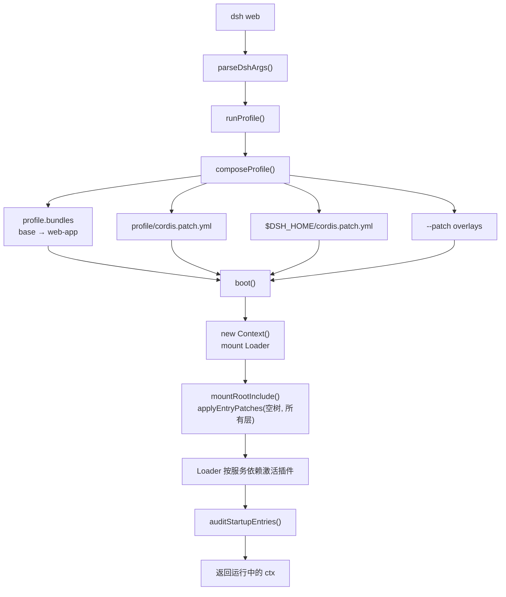

> 源码基于 [`deepseek-harness@0.2.1-rc.2`](https://github.com/deepseek-ai/deepseek-harness/tree/687f282e8625c6b8d11ff58211a90524be2e4317)，对应 commit [`687f282`](https://github.com/deepseek-ai/deepseek-harness/tree/687f282e8625c6b8d11ff58211a90524be2e4317)。行号以该 commit 为准。

执行 `dsh web` 时，终端里只会打印一行访问地址。但在这一行之前，进程已经完成了参数解析、profile 定位、bundle 拼装、patch 覆盖、Cordis Loader 安装、几十个插件挂载，以及一次启动审计。

这篇沿着 `apps/cli` 和 `packages/boot` 把这条链路走一遍。理解它之后，你才能解释三个常见问题：为什么某个插件没生效、为什么改 `cordis.patch.yml` 能覆盖默认行为、为什么 desktop 和 SDK 能复用同一套 agent 运行时。

## 1. 入口只做分发

`dsh` 的 bin 入口很短。`runCli()` 先解析 `process.argv`，然后按 `mode` 分发：

```ts
// apps/cli/src/bin.ts
switch (invocation.mode) {
  case 'profile': {
    const { runProfile } = await import('./profile-boot.ts')
    await runProfile({ ... })
    break
  }
  case 'plugin': { ... }
  case 'dump-config': { ... }
}
```

见 [`bin.ts#L26-L48`](https://github.com/deepseek-ai/deepseek-harness/blob/687f282e8625c6b8d11ff58211a90524be2e4317/apps/cli/src/bin.ts#L26-L48)。

这里有两点值得注意：

- **动态 import。** 只有真的要启动 profile 时才加载 `profile-boot.ts`。`dsh --help`、`dsh plugin` 这类命令不必为启动链路付出加载成本。
- **`profile` 是默认的应用形态。** `web`、`headless`、`sdk`、`acp` 都不是独立的可执行文件，而是不同 profile 的名字。`apps/desktop` 也走同一条路，只是换了一个由应用自己管理的 profile 目录。

## 2. profile 是“组合”，不是“配置”

很多人第一次看到 `$DSH_HOME/profiles/web` 会以为它是一个大配置文件。实际上它更像一个**依赖清单 + 覆盖层**。

`Profile` 的结构是：

```ts
// packages/boot/app-boot/src/profile.ts
export interface Profile {
  name: string
  dir: string
  /** Bundle layers in `dsh.profile.bundles` order. */
  layers: ProfileLayer[]
  /** Absolute path of the profile's own patch file. */
  patchPath: string
  /** The profile's own patches; empty when the file is absent. */
  patches: PatchOptions[]
  skippedBundles: SkippedBundle[]
}
```

见 [`profile.ts#L89-L100`](https://github.com/deepseek-ai/deepseek-harness/blob/687f282e8625c6b8d11ff58211a90524be2e4317/packages/boot/app-boot/src/profile.ts#L89-L100)。

`composeProfile()` 负责准备这些层：加载 profile、计算运行时解析、读取命令行 overlay；真正的合成发生在 `boot()` 挂载根配置时：

```ts
// apps/cli/src/profile-boot.ts
const profile = resolvedProfile?.profile ?? prepareProfile(name, true, fromDefaultProfile)
const resolution = await createRuntimeResolution({ installAnchor, profile })
const overlays = patchFiles.flatMap(file => loadOverlayPatches(NAME, resolve(file)))
return { profile, resolution, overlays }
```

见 [`profile-boot.ts#L224-L236`](https://github.com/deepseek-ai/deepseek-harness/blob/687f282e8625c6b8d11ff58211a90524be2e4317/apps/cli/src/profile-boot.ts#L224-L236)。

层序在注释里写得很清楚（[`profile-boot.ts#L211-L217`](https://github.com/deepseek-ai/deepseek-harness/blob/687f282e8625c6b8d11ff58211a90524be2e4317/apps/cli/src/profile-boot.ts#L211-L217)）：

1. `dsh.profile.bundles` 里列出的 bundle，按顺序；
2. profile 自己的 `cordis.patch.yml`；
3. `$DSH_HOME/cordis.patch.yml`（机器级偏好，优先级高于 profile 级）；
4. 命令行 `--patch` 覆盖文件，按 argv 顺序；
5. telemetry 开关。

后应用的层覆盖前面的层。**同一个插件行按 `id` 匹配，替换的是整个 `config`，不是深合并。** 这意味着覆盖一个配置时，要把想保留的字段重新写全。

### bundle 长什么样

一个 bundle 本质上是一份可安装的 patch 文件。`packages/bundle/base/package.json` 里声明：

```json
{
  "dsh": {
    "bundle": { "patch": "./cordis.patch.yml" }
  }
}
```

而 `base/cordis.patch.yml` 的第一段就是一次 `insert`（下面只节选了几行）：

```yaml
- insert:
    - id: tool-plugin-manager
      name: '@deepseek-ai/dsh-plugin-manager/tools'
      disabled: true

    - id: llm
      name: '@deepseek-ai/dsh-llm'

    - id: session
      name: '@deepseek-ai/dsh-session'

    - id: agent
      name: '@deepseek-ai/dsh-agent'
```

见 [`cordis.patch.yml#L15-L45`](https://github.com/deepseek-ai/deepseek-harness/blob/687f282e8625c6b8d11ff58211a90524be2e4317/packages/bundle/base/cordis.patch.yml#L15-L45)。`web` profile 先叠 `base`，再叠 `web-app`。`web-app` 的 patch 会按 id 改写 base 里的行，例如给 `tools` 加上 `mode`、给 `system-prompt` 加上 persona，并插入 `webserver`、`web-runtime` 这些只有浏览器形态才需要的行。

所以，“web 版 dsh”不是一个写死的应用，而是 **base 这层通用能力 + web-app 这层浏览器外壳 + 用户覆盖** 的合成结果。

## 3. `boot()` 只做五件事

`packages/boot/app-boot` 的 `boot()` 是整条链路的核心。删掉错误处理和日志后，它的骨架是：

```ts
// packages/boot/app-boot/src/index.ts（示意）
const ctx = new Context()
await ctx.plugin(Loader)
await prepare?.(ctx)
await mountRootInclude(ctx, absoluteConfigPath, patches, bareModuleBaseUrl, binName)
await ctx.get('loader')?.await()
await auditStartupEntries(ctx, binName)
return ctx
```

对应 [`index.ts#L1200-L1260`](https://github.com/deepseek-ai/deepseek-harness/blob/687f282e8625c6b8d11ff58211a90524be2e4317/packages/boot/app-boot/src/index.ts#L1200-L1260)。

逐步看：

1. **创建根 Context。** Cordis 的所有 service、event、effect 都挂在这个 Context 的 fiber 树上。
2. **安装 Loader。** Loader 负责读 `cordis.yml` / patch、解析模块、按服务依赖激活插件。
3. **`prepare` 注入启动事实。** `profile-boot` 在这里 `provide('profileContext', ...)` 和 `provideCmdline(...)`。很多 base 行用 `!!js "ctx.get('profileContext')"` 判断自己是否该启用，依赖的就是这个时机。
4. **挂载根配置。** `mountRootInclude` 把 profile 的 patch 层应用到空 entry list 上，得到最终的插件行，再交给 Loader。
5. **审计激活结果。** `auditStartupEntries` 检查必需插件是否真的 ACTIVE；失败会带上插件 id 和原始错误，而不是静默跳过。

`boot()` 的 catch 分支也值得一读：它先把根 fiber 整个 dispose，再根据失败发生在 `prepare` 之前还是之后，给出 `host preparation failed` 或 `plugin tree failed to load` 两种标签（[`index.ts#L1246-L1260`](https://github.com/deepseek-ai/deepseek-harness/blob/687f282e8625c6b8d11ff58211a90524be2e4317/packages/boot/app-boot/src/index.ts#L1246-L1260)）。这是 DSH 的一条设计原则：**配置错误要在最早能确定的地方大声失败**。

## 4. 一条完整的启动链路

把上面的片段接起来：



`runProfile()` 还做了几件容易被忽略的事（[`profile-boot.ts#L271-L346`](https://github.com/deepseek-ai/deepseek-harness/blob/687f282e8625c6b8d11ff58211a90524be2e4317/apps/cli/src/profile-boot.ts#L271-L346)）：

- 在第一个插件挂载前安装代理设置。Node 的 `fetch` 不会自动读代理环境变量，DSH 从启动快照里解析，保证 `.env` 里的代理也生效。
- 把 `SIGTERM` / `SIGINT` 接到 `shutdown`，并且在 **startup 窗口内**就接管，而不是等 `boot()` 返回后才接管。
- 用 `appReady` 标记“应用真的起来了”。Web 网关会等这个信号之后才注册 WebSocket 路由，避免重启期间接到半初始化的连接。

这些细节说明：DSH 把“启动”当成一个需要被观测和中断的生命周期，而不是一串同步初始化语句。

## 5. 为什么用 patch，而不是 if/else

如果只是想支持 web 和 headless，最直接的做法是写两个入口、共享一个库。DSH 选择了更重的一条路：**所有形态共享一个 launcher，用 patch 层描述差异**。

收益是：

- **可替换性一致。** 用户覆盖一行配置的方式，和官方 bundle 覆盖另一行配置的方式完全相同；不存在“只有核心能改”的配置。
- **HMR 有统一对象。** `dsh-hmr` 监听的就是 profile manifest 和 patch 文件，重载时重新走同一条合成逻辑。
- **新形态不需要新 bin。** 加一个 `acp` 或 `sdk` profile，主要是多一层 bundle patch；它们和 web 共用 `dsh` 这个入口。
- **可审计。** `dsh --profile web --dump-config` 打印的就是最终会被挂载的 entry list，并且用注释标出每一行来自哪个文件、被哪一层改过。

代价也很明显：**间接层很多**。看代码时如果只打开某个 `index.ts`，很容易不知道这个插件到底有没有被挂载。所以读 DSH 源码时，我养成了一个习惯：先 `--dump-config` 看它在这台机器上的真实形态，再回去读源码。

## 6. 动手验证

```sh
# 打印最终插件树（不会真的启动）
dsh --profile web --dump-config

# 只显示默认模板，不含用户覆盖
dsh --profile web --dump-default-config
```

如果想验证 patch 的覆盖规则，可以写一个小 overlay：

```yaml
# /tmp/disable-search.yml
- id: web-search-deepseek
  disabled: true
```

```sh
dsh --profile web --patch /tmp/disable-search.yml --dump-config
```

你应该能看到对应行的 `disabled` 变为 `true`，而其他行保持不变。注意：**替换 `config` 时是整个替换**，所以覆盖一个带多个字段的插件时，最好从 dump 里把那一段复制出来再改。

## 小结

- `dsh web` 的入口只做参数分发，真正的应用形态由 profile 决定。
- profile = 有序 bundle 层 + profile patch + home patch + `--patch`，后写获胜。
- `boot()` 的职责是创建 Context、装 Loader、注入启动事实、应用补丁、审计激活。
- 同一套机制支撑 web、headless、SDK、ACP 和 desktop，这是“没有特权核心”在启动层的体现。

下一篇进入 Cordis 本身：为什么 `ctx.tools.register()` 返回的 disposer 能让插件卸载时自动清理，以及 `agent/pre-step` 这种 waterfall 事件到底怎样改变主循环的行为。
