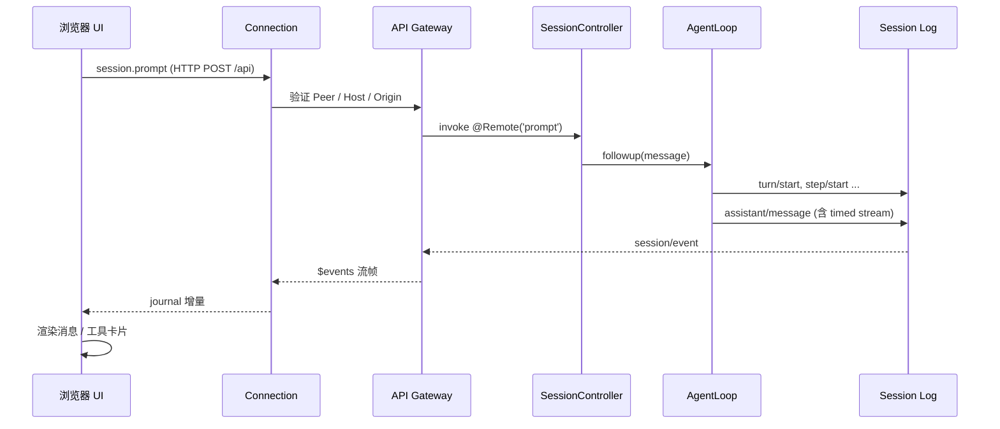

> 源码基于 [`deepseek-harness@0.2.1-rc.2`](https://github.com/deepseek-ai/deepseek-harness/tree/687f282e8625c6b8d11ff58211a90524be2e4317)，对应 commit [`687f282`](https://github.com/deepseek-ai/deepseek-harness/tree/687f282e8625c6b8d11ff58211a90524be2e4317)。

前面几篇都在进程内部打转。这一篇把视角拉到进程外：一个外部程序怎样驱动 DSH，浏览器又怎样实时看到 agent 的流式输出。

DSH 有两条对外通道：

- **SDK**：新行分隔的 JSON-RPC 2.0，走 stdio，适合 Python/Node 这类外部进程；
- **Web**：HTTP + WebSocket，走 Remote/Gateway，适合浏览器 GUI。

它们看起来完全不同，但底层驱动的是同一个 `ctx.agents` 和同一份 session log。理解这一点，就能理解为什么 DSH 的 Web UI 不是“另一个 agent 实现”。

## 1. 一个 runtime，三种驱动方式

```text
dsh --profile headless "task"     → 一次性 CLI
外部进程 --stdio JSON-RPC--> dsh --profile sdk   → SDK
浏览器 --HTTP/WebSocket--> dsh --profile web     → Web GUI
```

三种形态共享 `dsh-base` bundle：模型 adapter、工具、会话、沙箱、审批都在里面。差别只在最外层的入口和传输层。

这也是 DSH 反复强调 **application launch** 的原因：所有受支持的 Node 应用都必须通过命名 profile 启动，不能自带一个绕过 `dsh` 的入口。这样 session 目录、模型配置、插件组合才有一致的来源。

## 2. SDK：新行分隔的 JSON-RPC

协议包很小，核心就是一行一个 JSON-RPC 2.0 帧（[`sdk/protocol/src/transport.ts#L1-L8`](https://github.com/deepseek-ai/deepseek-harness/blob/687f282e8625c6b8d11ff58211a90524be2e4317/packages/sdk/protocol/src/transport.ts#L1-L8)）：

```text
{ "jsonrpc": "2.0", "id": "req_...", "method": "session/prompt", "params": {...} }
{ "jsonrpc": "2.0", "id": "req_...", "result": {...} }
{ "jsonrpc": "2.0", "method": "session/event", "params": {...} }
```

- 同时有 `id` 和 `method`：请求；
- 只有 `id`：响应；
- 只有 `method`：通知。

`JsonRpcLineTransport` 用 `StringDecoder` 处理跨 chunk 的 UTF-8，按行切帧，维护 pending map，把响应和请求配对（[`transport.ts#L62-L110`](https://github.com/deepseek-ai/deepseek-harness/blob/687f282e8625c6b8d11ff58211a90524be2e4317/packages/sdk/protocol/src/transport.ts#L62-L110)）。畸形行会被忽略，handler 抛错会变成 `-32603` 错误响应。

服务端是一个 Cordis 插件。`handleRequest()` 的方法表很短（[`server.ts#L343-L375`](https://github.com/deepseek-ai/deepseek-harness/blob/687f282e8625c6b8d11ff58211a90524be2e4317/packages/sdk/server/src/server.ts#L343-L375)）：

| 方法 | 作用 |
|---|---|
| `initialize` | 确定 cwd、provider、model、reasoning effort、max tokens |
| `session/prompt` | 投递一条用户消息 |
| `session/resume` | 恢复一个持久会话 |
| `session/wait` | 等待当前工作结束 |
| `session/working-directory/get` / `set` | 读写工作目录 |
| `shutdown` | 关闭 runtime |

服务端内部并不神秘：`createSession()` 调 `ctx.agents.create()` 或 `ctx.agents.resume()`，`prompt()` 调 `agent.followup()`（[`server.ts#L398-L420`](https://github.com/deepseek-ai/deepseek-harness/blob/687f282e8625c6b8d11ff58211a90524be2e4317/packages/sdk/server/src/server.ts#L398-L420)）。真正的 agent 生命周期仍然由 agent-loop 管。

客户端（TypeScript 或 Python）负责：

1. spawn 一个 `dsh --profile sdk` 子进程；
2. 通过 stdin 写请求、stdout 读响应/通知；
3. 把 `session/event` 通知翻译成回调。

为什么走进程边界而不是直接 import？因为 SDK 要的是一个**完整 runtime**：它有自己的模型路由、工具配置、会话目录和文件系统视图。进程隔离让“外部程序崩溃”和“agent runtime 崩溃”互不牵连，也让 Python 这类非 Node 调用方有统一入口。

## 3. Web：浏览器只是另一个 Cordis 树

`dsh web` 启动 `web` profile。这个 profile 在 base 之上插入：

- `webserver`：HTTP 服务和路由；
- `frontend-static`：提供构建好的 SPA；
- 一组 `dsh.client` 行：浏览器端要加载的 UI 插件 roster；
- `web-runtime`：处理启动参数、URL、浏览器打开。

浏览器页面由 `apps/web/src/main.ts` 启动（[`main.ts#L17-L20`](https://github.com/deepseek-ai/deepseek-harness/blob/687f282e8625c6b8d11ff58211a90524be2e4317/apps/web/src/main.ts#L17-L20)）：

```ts
const entry = new AppWebEntry(el)
void entry.run(desktop === undefined ? undefined : reportFailure)
```

`AppWebEntry` 来自 `@deepseek-ai/dsh-client-web`。Host 在返回 HTML 时注入 `window.__DSH_BOOT__`（模块清单、连接信息等），浏览器端据此加载 client 插件，形成**页面内的第二棵 Cordis 树**。

这棵树和 Host 树通过 Connection 通信，而不是共享内存：

- 浏览器插件注册 UI slot、命令、渲染器；
- 需要数据时通过 `ctx.remote` 调 Host 的 Remote 方法；
- Host 的 `session/event` 通过 `$events` 流推回页面。

## 4. 连接：HTTP 负责请求，WebSocket 负责流

Connection 层的职责是把“浏览器到 Host”的传输抽象出来（[`client/connection/README.md`](https://github.com/deepseek-ai/deepseek-harness/blob/687f282e8625c6b8d11ff58211a90524be2e4317/packages/client/connection/README.md)）：

- **一元调用**：HTTP POST 到 `/api`，JSON 请求/响应；二进制结果用 multipart 附件表。
- **流**：WebSocket `/api/remote.mux`，多条逻辑流复用同一个 socket，每条流有自己的 uplink/downlink。
- **启动认证**：`dsh web` 打印带 token 的 URL；根路径用 token 换一个签名 cookie，然后 302 到干净路径。
- **请求信任**：Host/Origin 必须匹配 listener 或 `trustedHosts`；这防的是 DNS rebinding 和跨站请求，不是身份认证。

认证和信任是两件事，Connection 的 README 写得很明确：Host/Origin 检查失败返回 403，通过检查但没认证返回 401。

`$events` 是 Gateway 保留的逻辑流（[`gateway/src/stream-protocol.ts#L7-L13`](https://github.com/deepseek-ai/deepseek-harness/blob/687f282e8625c6b8d11ff58211a90524be2e4317/packages/api/gateway/src/stream-protocol.ts#L7-L13)）：

```ts
export const REMOTE_STREAM_MUX_PATH = '/api/remote.mux'
export const REMOTE_EVENT_STREAM_ENDPOINT = '$events'
export const REMOTE_EVENT_RESULT_ENDPOINT = '$events/result'
```

Host 在 `$events` 打开时先发一个 `{ type: 'ready', ... }`，然后才开始发增量事件。浏览器端必须等到 `ready` 才发布“已连接”的代际，否则基线读取可能跑在增量监听之前。

## 5. 一次 Web 提问的完整路径

把上面的碎片拼起来：



关键点：

- **prompt 是一元调用**，走 HTTP。它只返回“已接受”，不等待整个 turn 完成。
- **事件是流**，走 WebSocket。浏览器订阅的是 `session/event`，不是轮询。
- **实时 chunk 是另一条通道**。`assistant/live-chunk` 只存在于浏览器端的 journal 里，用于在 `assistant/message` 落账前显示正在生成的内容；它不会进入持久历史。
- **顺序由 seq 保证**。浏览器端的 journal 只发布连续的 `replace` / `prepend` / `append` / `settle-assistant` 变化；发现缺口就通过历史分页修复。
- **重连是常态**。Connection 用 50%–100% 抖动的指数退避重试，重连后重新打开 `$events`，并用游标补齐。

`SessionController.prompt()` 本身很薄：校验内容、构造 `MessageSource`、记录非 owner 的 principal，然后交给 `commands.prompt()`（[`session-controller/src/index.ts#L461-L488`](https://github.com/deepseek-ai/deepseek-harness/blob/687f282e8625c6b8d11ff58211a90524be2e4317/packages/api/session-controller/src/index.ts#L461-L488)）。它不直接跑 agent，也不解析模型输出。

## 6. Remote 是什么

`ctx.remote` 是浏览器端的类型化 RPC 门面。Host 端用装饰器声明方法：

```ts
@Remote('prompt')
async prompt(request: SessionPromptRequest, signal: AbortSignal): Promise<SessionPromptValue> {
  // ...
}
```

构建时生成 descriptor 和 TypeScript 类型，Client 端因此能拿到 `ctx.remote.session.prompt(...)` 这样的方法，而不需要手写字符串和参数拼装。

Gateway 在 Host 侧负责：

- 解析 endpoint；
- 按 Typert 类型校验参数；
- 解析 lookup / Context 身份；
- 检查 `remoteAccess` 策略；
- 调用业务 Service；
- 把结果编码成 JSON 或带附件的 multipart。

流式方法用 `@Remote({ mode: 'stream' })`，返回 `Iterable` / `AsyncIterable`；Client 端拿到 `RemoteStreamHandle`，可以迭代 downlink、`send()` uplink、`end()` 半关闭、`dispose()` 取消。

## 7. 为什么不用一条通道解决所有事

理论上可以全部走 WebSocket，或者全部走 HTTP。DSH 选择分开，是因为两者的需求不同：

- **一元调用**需要简单、易调试、和普通 HTTP 基础设施兼容；失败重试也简单。
- **流**需要双向、背压、取消、复用连接、心跳和重连；这些用 HTTP 做会很别扭。
- **认证**只需要在入口做一次：HTTP 换 cookie，WebSocket 复用同一个 cookie。
- **事件顺序**由逻辑流和 seq 管理，而不是依赖 TCP 的字节顺序。

代价是链路长：浏览器 → Connection → Gateway → Service → Agent → Session → 再反向回来。任何一段出问题，表现都可能是“UI 不动了”。所以 DSH 在每一层都留了可观测点：Connection generation、Gateway 的 stream 状态、session seq、agent status。

## 8. SDK 和 Web 的共性

对比一下两条通道：

| | SDK | Web |
|---|---|---|
| 传输 | stdio，新行 JSON-RPC | HTTP + WebSocket |
| 请求 | `session/prompt` | `session.prompt` Remote |
| 事件 | `session/event` 通知 | `$events` 逻辑流 |
| 生命周期 | 子进程 | 浏览器页面 + Host |
| 认证 | 进程边界 / 启动参数 | token → cookie + Host/Origin |
| 复用 | 同一个 `dsh --profile sdk` | 同一个 `dsh --profile web` |

它们共享的不是传输代码，而是**下面这层语义**：

- 会话由 session id 标识；
- prompt 是“投递并返回接受”，不是同步等待结果；
- 进度通过事件流观察；
- 取消通过 signal / cancel 方法传播；
- 历史从 session log 读取，不另存一份。

这就是为什么 DSH 能同时支持 Python SDK、浏览器 GUI 和 CLI，而不需要为每个前端写一套 agent。

## 小结

- SDK 用新行分隔 JSON-RPC，把完整 runtime 放在子进程里；服务端方法很薄，核心仍是 `ctx.agents`。
- Web 的浏览器端是第二棵 Cordis 树，通过 Connection 与 Host 通信。
- 一元调用走 HTTP，流走 `/api/remote.mux`；`$events` 承载 session 事件。
- Remote 是类型化 RPC，Gateway 负责校验、鉴权、编码和流生命周期。
- SDK 与 Web 共享会话、prompt、事件、取消这些语义，只是传输和生命周期不同。

## 写在最后

这七篇走完，DSH 的整体形状应该清楚了：

```text
profile/bundle/patch  →  插件树
        ↓
   Cordis service/event/effect
        ↓
   AgentLoop → Tools → Session
        ↓
   LLM adapter → StreamChunk
        ↓
   SDK / Web 两种外壳
```

它不是一个“把 LLM 包一层”的框架，而是一个**把 agent 运行时拆成可组合能力**的系统。读它的源码，最有价值的可能不是记住某个 API，而是看它怎样用事件、effect 和持久日志，把“不确定性极高的模型调用”变成一个可观测、可恢复、可扩展的工程对象。

如果这套文章对你有帮助，或者你想看某个包的更细拆解（比如 compaction、subagent、workflow、PTC），可以继续在这个专栏里加。
