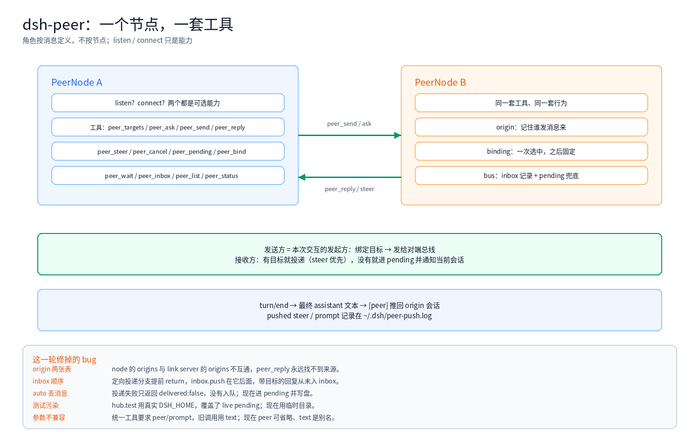

The previous two posts covered [session selection](/en/architecture/dsh-peer-selection.html) and [asynchronous result routing](/en/architecture/dsh-peer-result-push.html). This one closes the loop: **removing the hub and link roles**.

As long as there are two node types, there are two tool sets and half the behavior is wrong; every fix creates a new asymmetry.

<!-- more -->

## 1. The wrong starting point

The original model:

```text
hub  = listens, routes, owns the pending queue
link = connects, replies
```

So the tools split in two:

- hub: `peer_ask` / `peer_send` / `peer_steer` / `peer_cancel` / `peer_pending` / `peer_bind` ...
- link: `peer_reply` / `peer_send` / `peer_status`

Consequences:

- the link cannot `peer_ask`; it sends and waits for a push
- the link has no `peer_pending` / `peer_inbox`, so inbound messages are invisible
- origin is recorded only on the hub; the link cannot reply to it

**A role is a property of one exchange, not of a node**: whoever sends is this exchange's initiator; whoever receives is its target. The next exchange can reverse.

## 2. One node



```text
PeerNode
├─ listen?    optional capability
├─ connect?   optional capability
├─ one tool set (12 tools)
├─ origin     local session <-> peer session
├─ binding    chosen once, then fixed
└─ bus        inbox record + pending fallback
```

Both entry points construct a `PeerNode`, wrap the existing transports as capabilities, and call the **same** `registerPeerTools`.

## 3. One tool set

```text
peer_targets / peer_ask / peer_send / peer_reply
peer_steer / peer_cancel / peer_pending / peer_bind
peer_wait / peer_inbox / peer_list / peer_status
```

Same names, same parameters, same behavior on both ends. `peer` may be omitted when a node has a single peer, and `text` is an alias for `prompt`.

## 4. Bind once, then fixed

```text
first send from a local session
  → userQuestions.ask: remote workspace + remote session
  → remember the binding (local session + peer → remote session)
  → no more questions
```

When the conversation already has an **origin** (the peer messaged it), that origin is used and no card appears — an unattended node is never blocked on a picker.

## 5. Reverse capabilities

The hub serves:

```text
peer/steer   inject into a local session via the session controller
peer/cancel  abort a local session
```

The link's `peer_steer` / `peer_cancel` call those, defaulting to the origin.

## 6. A lightweight bus

No full message protocol, only record + fallback:

```text
inbound message
  → record in inbox (peer_wait / peer_inbox)
  → target present and writable → deliver
  → otherwise → pending (peer_pending / peer_bind)
```

Every inbound message is recorded; only failed deliveries queue. Nothing is lost, and normal traffic does not pile up.

## 7. Perception: queue or steer

The most subtle bug. Delivery used `sessionController.prompt(mode: 'queue')`:

- delivery reported success
- the message waited for the **next** turn
- the running turn never saw it
- the user saw a queued message in the GUI and asked why the agent could not perceive it

Switched to `mode: 'steer'`: injected at the next step, perceived immediately. When the session is idle, steer starts a turn.

When a message lands in pending, the hub also notifies the most recently active session:

```text
[peer] a message from macmini entered pending (id):
...
Use peer_pending to inspect it, then peer_bind to choose a session.
```

## 8. Bugs fixed in this round

| Symptom | Root cause | Fix |
|---|---|---|
| `peer_reply` always reports no origin | `PeerNode.origins` and the link server's origins were two maps | `originFor` falls back to the capability |
| targeted replies never reach the inbox | the targeted branch returned before `inbox.push` | record inbound before the branch |
| queued messages vanished | auto mode returned `delivered:false` without enqueueing | failures join pending and are persisted |
| live pending overwritten | `hub.test` used the real `DSH_HOME` | tests use a temp directory |
| `peer_send` fails validation | the unified tool required `peer` + `prompt`; callers passed `text` | `peer` optional, `text` alias |
| unattended node blocks | every send opened the picker | skip it when an origin exists |
| the agent misses queued messages | inbound used queue | inbound uses steer |

## 9. Testing method changed too

- unit tests use a temporary `DSH_HOME`, never the live queue
- integration tests use in-memory transports, not a real peer
- live verification runs once with steps, expectations, and actual output
- no repeated test messages in production conversations

## 10. Lessons

- **Align the model before writing code**: a wrong node type produces patches forever
- **Symmetry is not a slogan**: tools, origin, result routing, and errors must be one implementation
- **Separate message from delivery**: received ≠ delivered ≠ user-visible
- **Leave evidence**: `peer-push.log`, the pending file, the inbox
- **Isolate tests**: a test that writes the real queue destroys real data
