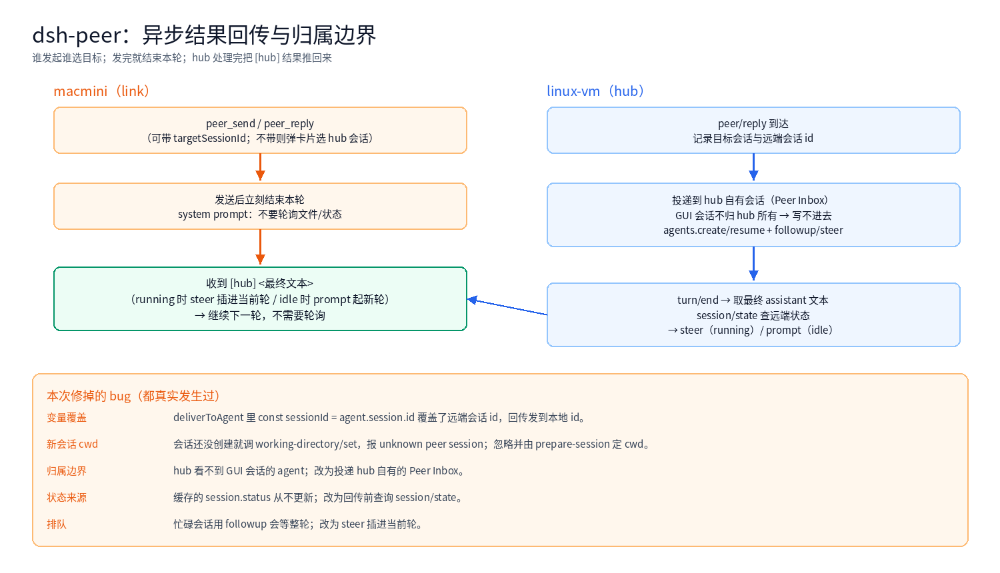

The [previous post](/en/architecture/dsh-peer-selection.html) covered choosing a session. The real problem appeared afterwards: **how does the result get back to whoever sent the message?**

This post records the final design — asynchronous result routing — and the bugs found along the way. None of them are exotic, but each one made the whole link look completely dead.

<!-- more -->

## 1. Final shape



```text
macmini: peer_send / peer_reply (optional targetSessionId)
  → send, then end the turn (system prompt: do not poll)
hub: deliver to a hub-owned session (Peer Inbox)
  → run one turn
  → at turn/end, take the final assistant text
  → query session/state
  → steer when running, prompt when idle
  → push `[hub] <text>` back to the initiating macmini session
macmini: receive [hub] ... → continue with the next round
```

No blocking, no polling, and no dependency on the hub agent remembering to reply.

## 2. Ownership: the hub cannot write into GUI sessions

The least intuitive constraint. In DSH every agent has an owner:

- a GUI session's agent is created and held by the GUI session controller
- the peer plugin's `agents.get(id)` returns nothing, and `resume` fails too

So "deliver into the session the user is watching" is not possible from a plugin. The solution is a session the hub creates itself:

```text
session id: peer-inbox (or peer-inbox-xxxx)
owner:      the hub plugin
visible:    attached to a workspace, so it appears in the GUI
```

Peer messages default there, its agent runs a turn, and the result is pushed back to macmini. A dedicated mailroom for peer traffic.

## 3. steer or prompt

The remote side may be running or idle when the result arrives:

| Remote state | Mechanism | Effect |
|---|---|---|
| running | `session/steer` | injected at the next step; polling stops |
| idle | `session/prompt` | starts a turn with `[hub]` as input |

Cached status is not trustworthy (`session.status` notifications never arrived), so query the link:

```js
const state = await link.conn.request('session/state', { sessionId })
const running = state?.status !== 'idle'
```

## 4. The real bugs

| Symptom | Root cause | Fix |
|---|---|---|
| macmini never receives results | `const sessionId = agent.session.id` inside `#deliverToAgent` **shadowed the parameter**, so `remoteSessionId` became the local id | local id only as the map key; keep the remote id |
| new session throws `unknown peer session` | `working-directory/set` called before the session exists | ignore the error; the new session takes its cwd from `peer/prepare-session` |
| hub finds no agent, messages land in pending | ownership isolation: GUI sessions are not writable | deliver to a hub-owned Peer Inbox |
| results always take the prompt path and queue | cached `session.status` stays idle forever | query `session/state` before pushing |
| busy sessions wait for the whole turn | `followup` only queues | steer when running |

The first bug is the archetype: it throws nothing, delivery works, but the push targets a session that does not exist. From the outside the link simply "does not answer".

## 5. How to verify

Do not trust "it should work now". Leave evidence:

```text
~/.dsh/peer-push.log
2026-11-07T16:16:42.002Z pushed prompt peer-macmini-fix1 bytes=46
```

And what macmini actually received:

```text
[hub] 收到，已忽略。

（hub 已完成这一轮，直接继续即可，不需要轮询。）
```

Push log on one side, received text on the other — that is a closed loop.

## 6. The cost of initiator-side choice

"Whoever initiates chooses the target" was the agreed direction:

- the link asks its local user which hub session to use
- without `targetSessionId` a card appears; if nobody answers, the send is cancelled

That is correct for interactive use but blocking for unattended work. Mitigations: remember the last choice, or default to a well-known target such as `peer-inbox`.

## 7. What was removed

An intermediate `peer_ask_hub` tool sent a message and waited synchronously for the hub turn's text. It duplicated the async push and:

- blocked the caller
- waited forever when the hub session was busy
- could deadlock if the hub called back synchronously

It was removed. **Prefer async unless you truly need a reply in the same call.**

## 8. Lessons

- **Understand ownership first**: a plugin can only write to sessions it owns
- **The push id must be the remote id**: a same-named local variable is a disaster
- **Do not trust cached status**: one `session/state` call beats notification bookkeeping
- **Confirm the process really restarted**: a scheduled restart silently did not run, and an old process wasted a long test
- **Add the log first**: `peer-push.log` turned a mystery into one line of failure
