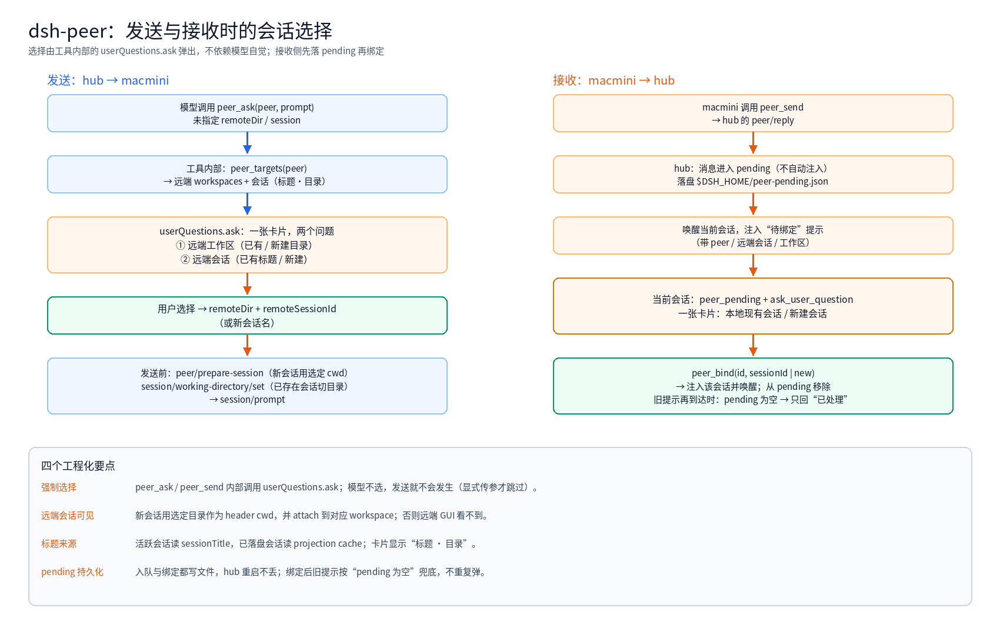

The [previous post](/en/architecture/dsh-peer-steer.html) covered steer and cancel. This one is about a different question: **when the other side sends a message, which session should receive it — and when I send, which remote workspace and session should it target?**

The first version injected messages into "the session that last called the peer". That is neither predictable nor explainable. It is now a **user choice**, and the choice is enforced inside the tool rather than left to the model.

> 中文版: [让选择落到会话上](/architecture/dsh-peer-selection.html)

<!-- more -->

## 1. Why choose a session at all

The early flow:

```text
link sends a message → hub finds "the local session that last peer_ask'ed this link" → inject
```

Three problems:

- When several local sessions talked to the same peer, the **last caller wins** and the reply may land in the wrong conversation.
- A peer session the hub never prompted has no caller, so the message falls back to a global guess.
- The remote side may have dozens of sessions; the user has no idea where a message will land.

So the target becomes explicit: **workspace + session**.

## 2. Sending: one card, two questions



1. `peer_targets(peer)` returns the remote side's workspaces and **all** sessions (live and persisted), with titles and directories.
2. The tool calls `userQuestions.ask` with two questions:
   - remote workspace: existing workspaces, or a new directory typed by the user
   - remote session: existing sessions (`title · directory`), or a new session name
3. Only after the answer does the tool continue with `remoteDir` and `remoteSessionId`.

The important part: **this happens inside the tool's `execute`**. `peer_ask`/`peer_send` await `pickRemoteTarget(...)` before `hub.ask`; without an answer, no send happens. The model cannot skip it — unless it passes `remoteDir` plus `session`/`remoteSessionId` explicitly (the operations path).

## 3. Receiving: pending first, then bind

```text
macmini peer_send
  → hub: peer/reply
  → pending queue (also written to $DSH_HOME/peer-pending.json)
  → wake the current session with a notice (peer / remote session / workspace)
  → that session: peer_pending + ask_user_question
       one card: existing local sessions / new session
  → peer_bind(id, sessionId | new)
  → inject into the chosen session and wake it
```

Details:

- **No automatic injection**: the message waits in pending until the user decides.
- **Durable**: enqueue and bind both write the file, so a hub restart does not lose the queue.
- **Stale notices**: after a successful bind, a late notice checks `peer_pending` first; when the id is gone it answers "already handled" instead of asking again.

## 4. Why the remote session is not visible in the GUI

The remote Web GUI lists sessions by **workspace**, filtered by the session header's cwd. Peer sessions were originally created with the link's default directory:

```text
session header cwd = /Users/patrick
no workspace with that path → the session is invisible
```

The fix has two parts:

1. Before creating a session, the hub sends `peer/prepare-session` with the chosen directory, and the link uses it as the **header cwd**.
2. After creation, the link finds the workspace with that path (creating it if needed) and calls `attachSession`.

Existing sessions keep their old header cwd; only new sessions land in the chosen workspace.

## 5. Where session titles come from

| Session state | Title source |
|---|---|
| live (in the link process) | `sessionTitle.get(session).title` |
| persisted but not open | the title projection in `sessionProjectionCache.cachedSnapshot(header)` |

The list is merged, sorted by `createdAt` descending, capped at 30; the card shows the most recent 8.

## 6. Pitfalls along the way

| Symptom | Cause | Fix |
|---|---|---|
| No existing sessions in the card | the hub listed only its in-memory `link.sessions`, empty after a restart | ask the link via `peer/sessions` and merge persisted sessions |
| Chose a directory, remote still ran in the old one | `working-directory/set` changes the projection, not the header; the SDK server's `ctx.workingDirectory` needs an injection | the link implements `set` itself and uses `peer/prepare-session` before creation |
| The card appeared even with explicit arguments | the picker was unconditional | skip it when `remoteDir` + `session`/`remoteSessionId` are provided |
| Pending messages vanished after a restart | in-memory queue | persist to `peer-pending.json` |
| A stale notice asked again after binding | the notice was already queued | check pending first; empty means "already handled" |

## 7. Still missing

- **A native in-app picker**: the choice is rendered by `userQuestions.ask` (two questions on one card), not a dedicated session-picker component.
- **Code-level permissions**: peer-origin turns still run with the user session's authority; they should use a restricted preset with human approval for privileged actions.
- **Header migration**: old sessions cannot change their header cwd; only new sessions get the chosen workspace.

## 8. Takeaways

- Make the target **explicit**: workspace and session are chosen, not inferred.
- Enforce inside the **tool**, not in the prompt: `userQuestions.ask` in `execute` cannot be skipped by the model.
- Visibility needs **header cwd + workspace attach**, not just "create a session".
- Cross-process state such as pending must be **durable**, or one restart loses it.
