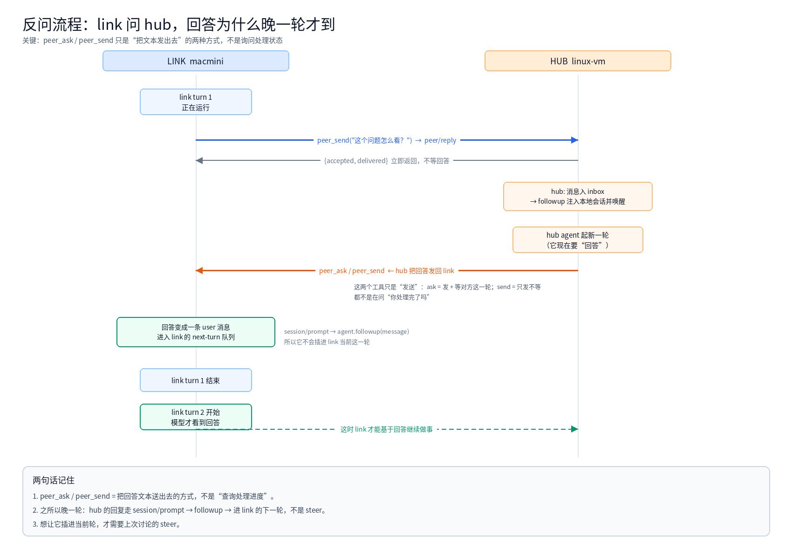
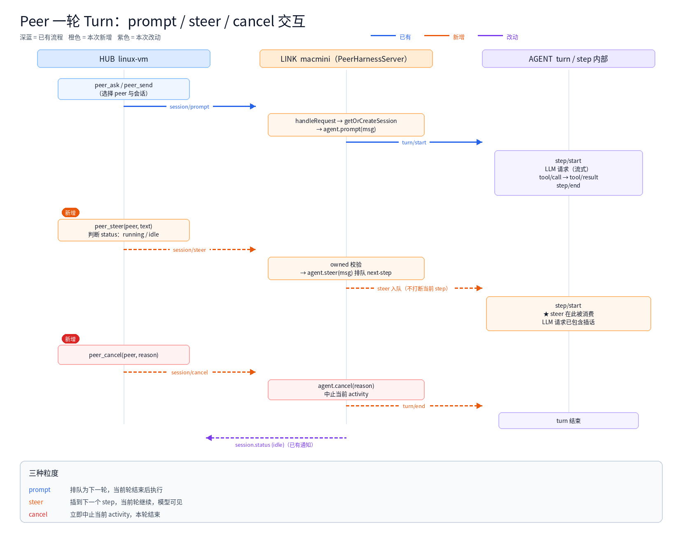

The [previous post](/en/architecture/dsh-peer.html) covered `dsh-peer`'s connection direction and activity dashboard. This one goes after a narrower question: **how do you interject while the other agent is in the middle of a turn, and even abort it?**

It took a while to see that DSH has three granularities of "sending a message": `prompt`, `steer`, and `cancel`. The difference is not in the network layer — it is in the agent loop's **turn/step boundaries**.

> 中文版: [给两个 agent 的对话加上 steer 与 cancel](/architecture/dsh-peer-steer.html)

<!-- more -->

## 1. A peer call is really a tool call

To the model, `peer_ask` is an ordinary tool:

```text
assistant: tool/call peer_ask { peer: "macmini", prompt: "run a long task" }
tool:      peer_ask result { text: "...", status: "completed", elapsedMs: 42000 }
```

The remote side is a full runtime with its own model, tools, and session, but here it is wrapped as a function from prompt to final text. That abstraction has three gaps: no streaming, no reverse question, and no preemption. The first two were patched with a session mirror and an inbox; this post is about the third.

## 2. How one turn actually runs

A turn consists of multiple steps; each step is one LLM request plus tool execution:

```text
turn/start
  ├─ step 1: step/start → LLM request → tool/call → tool/result → step/end
  ├─ step 2: step/start → LLM request → ...
  └─ turn/end
```

Before each step the driver claims messages from the **inbox**, which has two queues:

| Queue | Written by | Consumed |
|---|---|---|
| `next-turn` | `prompt` / `followup` | after the current turn, as the first input of the next turn |
| `next-step` | `steer` / `inject` | **before the next step starts**, inside the current turn |

```ts
followup(message) { this.send(message, 'next-turn', true) }
steer(message)    { this.send(message, 'next-step', true) }
cancel(cause)     { /* aborts the current activity */ }
```

Details that are easy to miss:

- **steer does not interrupt the current step** — running tools finish; the message is seen at the next step
- **steer can keep a turn alive** — if the model already decided to stop but `next-step` still has messages, the loop opens another step instead of breaking
- **cancel keeps the queue** — with `keepInbox: true`, queued steers survive for a later turn
- **the inbox is durable** — it is a session projection written into the session log, so it survives a restart

So the three granularities are:

```text
prompt  → next turn
steer   → next step (current turn continues)
cancel  → abort now (current turn ends)
```

## 3. Protocol design

Three wire methods served by the link's `PeerHarnessServer`:

| Method | Params | Result |
|---|---|---|
| `session/steer` | `{ sessionId, contentBlocks }` | `{ accepted, messageId }` |
| `session/cancel` | `{ sessionId, reason? }` | `{ cancelled, status }` |
| `session/state` | `{ sessionId }` | `{ status, seq }` |

The link-side implementation is short; the important line is the ownership check — it only touches sessions this server created:

```js
async handleRequest(method, params) {
  if (method === 'session/steer') return this.#steer(params)
  if (method === 'session/cancel') return this.#cancel(params)
  if (method === 'session/state') return this.#state(params)
  return super.handleRequest(method, params)
}

#steer(params) {
  const record = this.#record(params)          // throws for unknown sessions
  const message = createUserMessage({ content: params.contentBlocks, source: { kind: 'user' } })
  record.handle.agent.steer(message)           // next-step
  return { accepted: true, messageId: message.id }
}
```

The hub routes and rate-limits:

```js
async steer(request) {
  const link = this.require(request.peer)
  const sessionId = this.#sessionFor(link, request.session, false)
  const state = this.#state(link, sessionId)

  if (!this.#supportsSteer(link)) {             // version gate: < 0.3.0 degrades
    return this.#prompt(link, sessionId, request.text, 'prompt')
  }
  if (state.status === 'running') {
    const result = await link.conn.request('session/steer', { sessionId, contentBlocks })
    return { mode: 'steer', accepted: result.accepted, messageId: result.messageId }
  }
  return this.#prompt(link, sessionId, request.text, 'prompt')
}
```

Two more constraints:

- **Version gate**: links older than 0.3.0 get a prompt fallback for steer, and cancel fails loudly instead of hitting an unknown method
- **Rate limit**: 20 steer/cancel calls per peer per minute (`steerPerMinute`)

## 4. Why a reverse question always arrives a turn late

The hub's answer goes out as `session/prompt`, and the SDK server turns that into:

```ts
rec.handle.agent.followup(message)   // followup, not steer
```

`followup` lands in `next-turn`, so the answer is queued for the link's next turn:



- `peer_ask` / `peer_send` are just how the hub **sends its answer**; they are not a status query
- the answer becomes a user message in the link's next turn
- the link gets a delivery receipt, not the answer itself

A true request/response needs either a suspended RPC or a link-side inbox plus `peer_wait`.

## 5. Where the three granularities sit



## 6. The actual steer / cancel test

After macmini upgraded to 0.3.0:

```text
peer_send(peer="macmini", prompt="for i in $(seq 1 90); do echo tick $i; sleep 1; done; echo DONE_LONG_TASK")
→ Queued on [macmini] session peer-macmini-chat (message ffbc6bf8-...)

sleep 6

peer_steer(peer="macmini", text="...STEER_OK...")
→ Steered into macmini; delivered at its next step.   (mode: 'steer')

peer_cancel(peer="macmini", reason="steer/cancel test")
→ Cancelled the current turn on macmini.              (cancelled: true)
```

The link stayed connected afterwards:

```text
macmini (darwin/arm64, host ?, dsh 0.3.0) cwd=/Users/patrick
```

Two semantics to keep in mind:

1. **steer's "delivered" means queued.** While the 90-second command was still running, the message sat in `next-step`; the model would only see it after that step. We cancelled right after, so it stayed in the queue under `keepInbox: true` and will be consumed in the next turn — not lost.
2. **cancel aborts the turn, not the process.** The running shell command may still finish; the agent stops advancing.

## 7. The bug the test caught: a missing import

macmini kept reporting silent handshake failures. It looked like a network issue, but it was one import:

```diff
- import { PeerConnection, describeError, localIdentity } from './protocol.js'
+ import { PeerConnection, PEER_VERSION, describeError, localIdentity } from './protocol.js'
```

`link.js` used `PEER_VERSION` in `status()`, `peer/hello`, and reconnect state, but only `hub.js` imported it. Every dial threw a `ReferenceError` inside the handshake try/catch, was recorded as "handshake failed", and retried with backoff — the real exception never reached the log.

Fix: `38f6c10` on `feat/session-mirror`.

The lesson matters more than the fix: **on a cross-machine link, any error swallowed by a catch looks like a network problem.** Keep the original exception at least at the handshake boundary.

## 8. What is still missing

- **Code-level permission enforcement**: peer-origin messages are still plain user messages, and a peer-woken turn runs with the user session's authority. The next step is to pin peer-origin turns to a restricted preset and require human approval for privileged actions.
- **Link-side inbox / wait**: a link can send, but cannot wait for the hub's answer within the same turn.
- **Durable provenance**: carry `origin` on the wire and store it in the message source instead of relying on a text prefix.

## 9. Takeaways

- `prompt` / `steer` / `cancel` differ at the **turn/step boundary**, not on the wire
- steer is "next step", not an interrupt; cancel aborts the activity, not the process
- a version gate and a rate limit are part of the protocol, not polish
- when a cross-machine link misbehaves, suspect a swallowed exception before the network

Code:

- [SparksDing/dsh-peer](https://github.com/SparksDing/dsh-peer) (`feat/session-mirror`)
- fork: [SparksDing/deepseek-harness](https://github.com/SparksDing/deepseek-harness) (`feat/peer-session-mirror`)
